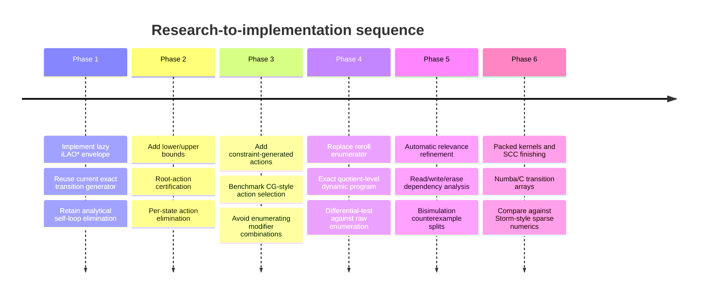

# Exact Planning for Huge Stochastic Shortest-Path Crafting Models

## Executive summary

The bottleneck in the current pipeline is not primarily the Bellman solve; it is **premature materialization**. In the hard R04 instance, the implementation constructs 177,242 abstract states and 535.9 million transitions—about 3,000 outgoing transitions per state—before it knows which states and outcomes can matter to an optimal policy. The graph build alone takes 3,526 s and 6.3 GB, and the later solve exhausts 15.7 GB; R14 reaches at least 787,605 states. The same model also contains near-unit self-loops, full rerolls with roughly 1,500 abstract outcomes, and operations that erase information accumulated earlier. fileciteturn0file0

The literature strongly supports changing the architecture from **“generate graph, then optimize” to “optimize while generating”**. LAO*/iLAO* and LRTDP are explicitly designed to avoid evaluating the entire reachable state space from a fixed initial state; BRTDP adds lower/upper value bounds and an anytime error certificate; and the newest constraint-generation work, CG-iLAO*, additionally avoids evaluating many actions even *inside states that have been expanded*. The 2026 CG-iLAO* paper reports that it considers about 40% of iLAO*'s actions on many problems, as little as 1% on some, computes 3.5× fewer action costs on average, and runs 2.8× faster than iLAO* and 3.7× faster than LRTDP on its benchmark suite. citeturn730867view0turn157925search0

For this particular application, however, simply replacing value iteration by iLAO* is not enough. A single Bellman backup of a full-reroll action can still materialize ~1,500 successors, and tens of thousands of compound operation variants can be applicable. The largest expected gain therefore comes from combining **lazy state expansion, lazy action generation, and exact quotient-level transition generation**. The last component is unusually important here: the raw stochastic draw process should produce probabilities **directly over abstract successor classes**, not generate raw element sequences and aggregate them afterward. Existing MDP bisimulation theory guarantees that merging states with identical rewards/costs and equal transition probabilities into every equivalence block preserves optimal policies; Dean–Givan–Greig explicitly develop such minimization for factored MDPs without requiring enumeration of the concrete state space first. citeturn730867view4turn887468search0

The recommended solver core is therefore an **iLAO*/CG-iLAO*-style explicit envelope solver with two-sided bounds**, retaining your existing exact analytical self-loop elimination and adding dynamic action elimination. Use a cheap admissible stochastic abstraction heuristic as the lower bound, and one or more explicit proper crafting recipes as executable upper bounds. Pattern databases, merge-and-shrink abstractions, cost partitioning, and occupation-measure relaxations have all been generalized to SSPs with admissibility guarantees; occupation-measure heuristics are particularly attractive because they retain transition probabilities instead of determinizing the problem. citeturn157925search1turn157925search2turn730867view3turn157925search5

The most important caveat is that **sampled RTDP variants are less naturally aligned with your worst cases than deterministic envelope expansion**. BRTDP is theoretically attractive because it maintains certified lower and upper bounds for SSPs with non-negative costs under standard proper-policy assumptions, but a state reached with probability 0.001 may be visited slowly by trajectory sampling even when its large downstream cost materially affects an expectation. BRTDP's gap-weighted exploration mitigates this, but it does not remove the basic mismatch. Its original formulation also assumes a proper policy exists and that every improper policy has infinite expected cost somewhere. citeturn730867view1 Your analytical elimination of stay-probability \(p\) into an equivalent macro-action cost \(c/(1-p)\) should therefore remain in the pipeline; it removes precisely the near-unit self-loops that otherwise make RTDP-style trajectories pathological. fileciteturn0file0

My ranking for the hard cases is:

| Priority | Change | Guarantee | Expected effect on R04/R14 | Implementation effort |
|---|---|---|---|---|
| **1** | Lazy iLAO*/CG-iLAO* envelope instead of full graph construction | Exact with admissible heuristic and certified convergence assumptions | **Very large**; plausibly removes most never-policy-relevant states and many actions | Medium |
| **2** | Compute reroll distributions directly in the current quotient | Exact if DP aggregates exactly equivalent outcomes | **Very large**; targets the ~1,500-successor actions and 535.9M-transition explosion directly | Medium–high |
| **3** | Strong stochastic lower bounds + executable upper bounds, with per-action pruning | Exact pruning; ε certificate from bounds | **Large**; especially important because your current first-level pruning already consumes ~half runtime | Medium |
| **4** | Automatic exact relevance/bisimulation refinement before and during search | Exact | **Large in erase/reset-heavy cases**, moderate elsewhere | High |
| **5** | Compact transition storage and model-checker-style sparse kernels | Exact numerics to selected tolerance | **Moderate to large** once graph-generation waste is reduced | Medium |
| **6** | BRTDP/FRTDP as secondary anytime solvers | Certified bounds under their SSP assumptions | Useful for fast incumbents; less robust for rare consequential successors | Low–medium |

The effect estimates in this table are **estimates for your structure, not published benchmark results**. Published evidence supports the mechanisms—partial state expansion, action elimination, abstraction and sparse/symbolic representation—but I found no published benchmark combining six-slot weighted group-exclusive draws, branching in the thousands, and 0.1–0.3% repeated-success events. The case-specific numbers above come from your supplied problem description. fileciteturn0file0

## Lazy SSP algorithms and certified decision search

### iLAO* / LAO*

LAO* generalizes AO* to solution graphs containing loops and can find an optimal MDP solution from a start state without evaluating the whole state space. Its central idea is to maintain a partial explicit graph, solve the currently relevant “best partial solution,” expand its fringe, and repeat until the solution envelope is closed and Bellman-consistent. citeturn584397search0 Modern work generally treats iLAO* as one of the state-of-the-art optimal SSP heuristic-search baselines alongside LRTDP. The 2026 constraint-generation paper emphasizes that iLAO* and LRTDP can be orders of magnitude faster than blind VI because they restrict Bellman backups to a promising subset of the state space. citeturn730867view0

**Fit here: excellent.** Unlike trajectory-sampling methods, an envelope algorithm does not have to “get lucky” and sample a 0.1% successor before recognizing that it exists: once an action is expanded, every abstract successor probability required for an exact Bellman backup is incorporated. The weakness is exactly your current transition explosion: vanilla iLAO* still computes all applicable action values during a backup and normally needs each selected action's full successor distribution. That is why it should be paired with action-level constraint generation and quotient-level outcome generation. citeturn730867view0

### CG-iLAO*

CG-iLAO* is unusually well matched to the “10,000 operation variants” dimension. Instead of treating each Bellman backup as “evaluate every applicable action and choose the minimum,” it formulates the heuristic-search problem through LP/constraint-generation ideas so that expensive actions need not even have their Q-values generated until they can plausibly become relevant. The accepted 2026 Artificial Intelligence manuscript reports average reductions of 3.5× in evaluated action costs and average runtime speedups of 2.8× versus iLAO* and 3.7× versus LRTDP, with some problems using as little as 1% of iLAO*'s actions. citeturn730867view0

This is likely the **highest-value algorithmic paper for your action branching problem**. The gain is complementary to state-space laziness: iLAO* says “do not expand irrelevant states,” while constraint generation says “inside relevant states, do not instantiate irrelevant actions.” For compound operations parameterized by up to four modifiers from a set of roughly 25, the action generator itself can be treated as a pricing/separation oracle rather than generating all combinations upfront. That last specialization is my inference from the CG-iLAO* mechanism, not a result established by its authors for crafting-type combinatorial actions. citeturn157925search9

### LRTDP, BRTDP, FRTDP and VPI-RTDP

LRTDP improves RTDP by labeling states as solved once the relevant Bellman conditions and successor dependencies are verified; it is a classic optimal heuristic-search method for SSPs. citeturn584397search3turn634165search1 It has very low graph-management overhead and naturally stores only visited states, but trajectory-based discovery is a poor match when important outcomes are extraordinarily rare unless successor-selection rules deliberately bias toward unresolved states.

BRTDP maintains monotone lower and upper value bounds and samples trajectories toward states that are both relevant and uncertain. It was explicitly developed for finite SSPs with a fixed initial state, non-negative costs, at least one proper policy, and the assumption that improper policies incur infinite expected cost somewhere; its output can carry a performance bound. citeturn730867view1 This makes it a good source of **certification machinery and incumbent-policy management**, even if I would not make its random trajectory policy the primary expansion strategy here.

FRTDP likewise uses two-sided bounds but chooses successor states using a focused priority rather than plain transition sampling; this is preferable when low-probability states retain a large value gap. citeturn634165search47 VPI-RTDP goes further and uses a value-of-perfect-information criterion for deciding what uncertainty is worth resolving; its authors report up to a roughly three-fold reduction in visited states/time for comparable policy quality on their experiments. citeturn634165search0turn634165search13 VPI-RTDP's Bayesian mechanism is useful inspiration for **decision-directed refinement**, but it is not the cleanest foundation for your strict deterministic certification requirements because its search-control model is heuristic even when the underlying bounds remain valid.

### FTVI

FTVI combines heuristic action elimination with SCC decomposition. It first performs heuristic search, proves some actions suboptimal, then decomposes the surviving graph into smaller SCCs and solves them topologically. The paper reports an order-of-magnitude average improvement over TVI across several domains and up to two orders of magnitude over LAO*, LRTDP and BRTDP on some tested instances. citeturn730867view2

FTVI is therefore highly relevant to your **existing SCC solver**, but it is not the first architectural change I would make. It still gains much of its advantage after a meaningful relevant graph is known; R04 currently dies while creating that graph. The useful transfer is: *prune actions before SCC construction, and construct SCCs only over the current optimal-policy envelope*. Once a lazy envelope stabilizes, your current SCC code can become the finishing solver for that envelope rather than a solver for all reachable states.

### Comparative assessment

| Method | Full-state avoidance | Two-sided certificate | Rare-outcome behavior | Near-1 loops | Action laziness | Memory profile | Recommendation |
|---|---:|---:|---|---|---:|---|---|
| LAO*/iLAO* | Strong | Lower-bound based; can certify Bellman convergence | Good once action expanded | Benefits strongly from your self-loop elimination | No, vanilla backups enumerate actions | Explicit partial graph | **Primary base** |
| CG-iLAO* | Strong | Same optimal SSP framework | Good | Same | **Yes** | Partial states + subset of actions | **Best match** |
| LRTDP | Strong | Optimal convergence under SSP assumptions | Can undersample rare successors | Poor without loop elimination | No | Very low | Useful baseline |
| BRTDP | Strong | **Yes, lower+upper** | Better than RTDP, but still trajectory driven | Poor without loop elimination | No | Very low | Excellent certification ideas |
| FRTDP | Strong | Two-sided | Better targeted than probability-only sampling | Same issue | No | Low | Secondary candidate |
| VPI-RTDP | Strong | Bounds retained; search priority heuristic | Explicitly values information | Same | No | Low | Inspiration for refinement |
| FTVI | Moderate | Exact final solve | Enumerates surviving transitions | Good after loop elimination | Action pruning first | Requires surviving graph/SCCs | Finishing phase |
| Full VI/PI + SCC | None | Yes | Exact | Your macro-loop method helps | No | Worst here | Retain only as fallback |

These guarantees are for expected total cost SSP objectives, not automatically for quantiles or CVaR. Risk-aware SSPs require modified state/objective formulations; one cannot replace the expectation Bellman operator by a p90 objective and retain all of the same theory unchanged. Dedicated “risk-aware SSP” formulations exist, but should be treated as a separate solver layer rather than assumed to inherit ordinary SSP guarantees. citeturn634165search38

## Bounds, pruning, and stopping as soon as the first decision is fixed

Your current first-level pruning already demonstrates the value of bound-based elimination, but it occurs too late and is apparently expensive enough to consume around half of runtime in one case. fileciteturn0file0 The better organization is to make the same proof principle **incremental at every state and action**.

Let \(L(s)\le V^*(s)\le U(s)\). For an action,
\[
L_Q(s,a)=c(s,a)+\sum_{s'}P(s'|s,a)L(s'),
\qquad
U_Q(s,a)=c(s,a)+\sum_{s'}P(s'|s,a)U(s').
\]
Then action \(a\) can be deleted permanently whenever
\[
L_Q(s,a)>\min_b U_Q(s,b).
\]
This is exact: even the most favorable completion of \(a\) is worse than an already feasible competitor. BRTDP's entire methodology is built around maintaining such lower/upper value bounds, and FTVI explicitly uses provably suboptimal-action elimination before topological solution. citeturn730867view1turn730867view2

For the root decision, the criterion can be even more aggressive. If the best offer \(a_1\) has \(U_Q(s_0,a_1)\) below every competing offer's lower bound, then **the optimal first action is already proven**. If you also want the reported optimal value to within one percent, continue only until \(U(s_0)-L(s_0)\le 0.01\,L(s_0)\) or your chosen absolute/relative criterion. This gives precisely the requested “stop when the decision is fixed” behavior; no convergence of unrelated parts of the value function is required.

For lower bounds, I would test the following hierarchy.

**Probabilistic pattern databases** are already developed specifically for SSPs and yield admissible abstraction heuristics; experiments in the cited work found them competitive and generally better than determinization-based heuristics. citeturn157925search1 Your required-element subsets are almost tailor-made patterns: solve exactly for one required affix, pairs, or small triples while dropping some slot/group constraints, then combine compatible patterns through SSP cost partitioning. Cost partitioning has been generalized formally to SSPs and preserves admissibility under its stated conditions. citeturn157925search5

**Merge-and-shrink** now has an SSP theory as well. Klößner et al. formulate shrinking, merging and label-reduction transformations for stochastic shortest-path factored models and give conditions under which the resulting abstraction heuristic is admissible or even perfect. citeturn157925search2 It is more infrastructure-heavy than small crafting-specific PDBs, but more automatic and likely stronger on goals requiring four to six interacting elements.

**Occupation-measure relaxations** are especially attractive when probability matters. Trevizan, Thiébaux and Haslum derive admissible SSP heuristics by relaxing the LP over expected state-action occupation counts, and emphasize that unlike the traditional determinization heuristics, these retain probabilistic information. citeturn730867view3 Your natural relaxations—independent required-element acquisition, relaxed slot capacities, relaxed group exclusion, or a Lagrange price on occupied P/S slots—can be expressed as weaker flow/resource constraints. Any relaxation enlarging the feasible-policy set of a cost-minimization problem gives a lower bound, provided the relaxed model's costs and transition treatment do not accidentally make actions *harder*. This is the most promising principled route for a “coupon collector but with operations” heuristic.

A very cheap first heuristic is the **min-min / all-outcomes relaxation** used historically in probabilistic planning: replace expected successor cost by the best successor's cost. The HDP literature uses \(h_{\min}\), obtained by replacing expectation in the Bellman backup by the most favorable outcome, as an admissible heuristic. citeturn634165search1 It is generally loose for 0.1% success actions because it ignores the low probability, so I would use it only as the first layer feeding a stronger stochastic PDB or occupation-measure bound.

For upper bounds, the key requirement is a **proper executable crafting policy**, not a numerical heuristic. You already have natural candidates: repeated full reroll until a subset appears; acquire one element, protect a side, then recurse; deterministic-add recipes; or the pessimistic abstraction policy you already compute. A proper policy can be evaluated exactly by solving its linear equations over its visited abstract states; BRTDP similarly relies on proper-policy upper bounds to obtain guarantees. citeturn730867view1 Maintaining several such incumbents is valuable because every improved upper bound immediately deletes additional actions.

## Exact quotient transitions and automatic removal of irrelevant detail

### Do not enumerate raw reroll outcomes

Your weighted sequential draw is a form of **weighted sampling without replacement**. The ordered probability of selecting items \(i_1,\dots,i_k\) sequentially is the Plackett–Luce product
\[
\Pr(i_1,\dots,i_k)
=\prod_{j=1}^{k}
\frac{w_{i_j}}
{\sum_{r\notin\{i_1,\dots,i_{j-1}\}}w_r},
\]
which is also the distribution generated by Gumbel-top-\(k\) sampling. citeturn410413search23 Once selecting one element removes its whole mutually exclusive group and P/S capacities modify what is eligible, the denominator depends on the *set of previously removed groups and capacity state*, not merely on draw count.

That distinction matters for generating functions. Elementary symmetric polynomials give exceptionally clean formulas for **conditional-Poisson/rejective** fixed-size weighted subset distributions, where an unordered subset probability is proportional to a product of odds. That is a different sampling law from successive Plackett–Luce selection. citeturn410413search5 I did **not** find a general closed-form elementary-symmetric-polynomial formula for your exact process with sequential weights, whole-group exclusion, two capacities, forced elements, tag multipliers and tag bans. Treating the process as rejective/Fisher noncentral-hypergeometric sampling would in general change the probabilities.

You do not need a closed form, though. Because \(k\le 6\), the right exact primitive is a **small-depth dynamic program over quotient-relevant sufficient statistics**. For a reroll, a DP node needs only the information that changes future denominators or the reported abstract result: current draw number; remaining P/S capacity; which required groups have been selected; tier information for required elements; and aggregated remaining total weights for each behavioral junk-group class. If two junk groups are identical under all enabled future operations and have the same internal weight/type/tag signature needed by the current draw, they enter the DP symmetrically rather than as distinct identities. That turns complexity from “number of raw ordered samples” into roughly “number of reachable sufficient-statistic vectors × \(k\) × number of behavioral classes.” This complexity statement is an algorithmic derivation for your model, not a published bound for this exact crafting process.

For required groups that contain multiple possible elements, the DP splits only on **abstractly distinct effects**. For junk groups, transition updates merely decrement an aggregate count/weight statistic. This is essentially variable elimination on the draw process. With at most six draws, even a moderately rich statistic can be dramatically smaller than enumerating every concrete group sequence.

A particularly useful implementation strategy is to make the transition generator itself **partition-aware**. Its public interface should be:
\[
\texttt{distribution(state, action, current\_partition)}
\rightarrow
\{(\text{abstract successor block},p)\},
\]
never “list every concrete outcome.” Whenever the planner's state partition is refined, memoized transitions whose target blocks split can be selectively recomputed.

### Exact bisimulation and online minimization

Dean and Givan define stochastic bisimulation/homogeneity so that states in the same block have equal immediate reward/cost and, for every action, identical probability of entering each equivalence block. The quotient MDP preserves optimal policies; their later treatment explicitly develops minimization over factored representations to avoid enumerating all ground states. citeturn887468search0turn730867view4 This is precisely the theoretical justification for your “behavioral group types.”

Lee and Yannakakis go one step closer to what you want operationally: their online transition-system minimization performs reachability analysis and minimization simultaneously rather than constructing the whole graph and minimizing afterward; the number of primitive operations is quadratic in the size of the final minimal reachable graph. citeturn887468search7 Dean and Givan explicitly connect these block-splitting methods to planning and note a reachable-model-minimization variant. citeturn887468search4

The practical design is therefore **counterexample-guided partition refinement**:

1. Start with the coarsest partition that distinguishes goal satisfaction, required tiers/values, flags, and any immediate action applicability/cost differences.
2. Generate only transitions of blocks reached by the current policy envelope.
3. If two states thought equivalent have different applicable actions, costs, or probabilities into an existing block, split that block.
4. Recompute only the affected transitions and continue until the explored quotient is stable.

This gives an exact abstraction if splitting continues to the bisimulation-fixed point. Classical Paige–Tarjan-style bisimulation algorithms achieve \(O(m\log n)\)-type complexity for explicit labeled transition systems; modern probabilistic partition-refinement algorithms retain similar near-linear/logarithmic structural complexity in the explicit transition representation. citeturn887468search8turn887468search9 The important caveat is that **explicit \(m\)** is exactly what you cannot afford, so the value comes from symbolic block operations and transition aggregation, not from running an \(O(m\log n)\) pass on the existing 535.9-million-edge graph.

### Automatically detecting erased detail

The strongest safe rule is **model irrelevance**, effectively the bisimulation condition: a feature can be discarded if, conditional on the retained features, it does not affect immediate cost, action availability, or the distribution over future retained features for any relevant action. Givan–Dean–Greig's exact abstraction provides the formal basis. citeturn730867view4

The “full reroll erases everything” pattern permits an even simpler backward relevance analysis in many cases. Suppose variable \(x\) influences neither costs nor action availability before an unavoidable erasing operation \(E\), and \(E\)'s post-state distribution is conditionally independent of \(x\). If every path from the current decision point to any action that can inspect \(x\) passes through \(E\), then \(x\) can be dropped for that region. This can be detected mechanically by a dependency graph whose nodes are state features and whose hyperedges record which features each operation reads, writes, preserves, and randomizes. Backward-slice from goal predicates and cost/applicability predicates; a feature whose influence is killed by a write before it reaches the slice is irrelevant. This is an application-specific static-analysis formulation rather than a theorem I found stated in exactly this crafting form.

It directly addresses the pathological case you reported: an initial “make it rare” reroll whose resulting detail is erased by the next operation should collapse to whatever *persistent flag or cost consequence* survives the erase, instead of generating a huge intermediate state layer. fileciteturn0file0

### Symbolic ADDs

SPUDD represents factored MDP transition functions and value functions using algebraic decision diagrams and performs dynamic programming directly on the diagrams. citeturn715694search0turn715694search3 Decision diagrams can represent enormous regular state spaces compactly, and PRISM similarly reports that symbolic MTBDD engines can sometimes analyze models far beyond what can be enumerated explicitly. citeturn526235search3

I would **not rank ADDs ahead of lazy explicit search for this application**. Your state is a sparse set of up to six elements drawn from hundreds, with group exclusion, capacities and highly parameterized operations. A Boolean encoding is possible, but cardinality/group constraints and irregular weighted transition denominators can create large diagrams. ADD size depends on structural regularity and variable ordering, not simply on state count. The promising hybrid is to use symbolic structures only for operation applicability or block predicates while keeping quotient states explicit.

## Engineering evidence and implementation architecture

Storm and PRISM demonstrate that the raw numerical solution of large probabilistic models need not be the limiting factor once representation is disciplined. Storm's 2022 evaluation uses 96 QComp instances, four Intel Xeon Platinum 8160 cores, a 12 GB memory limit and a 30-minute timeout; its various sparse, DD, hybrid and bisimulation configurations solve different subsets fastest, reinforcing that **representation choice can matter more than the linear solver**. citeturn526235search0turn526235search1 Storm exposes both sparse explicit and symbolic engines, symbolic bisimulation, sound numerical methods, exact checking modes, and a Python interface. citeturn526235search0turn526235search7

PRISM's documentation states that its default hybrid engine commonly handles \(10^7\)–\(10^8\) states on a typical PC, with some MTBDD case studies reaching \(10^{10}\)–\(10^{11}\) symbolic states; those numbers are **tool documentation claims and highly model-dependent, not evidence that your 3,000-branch SSP will fit**. citeturn526235search3 A retrospective comparison reports a roughly 1.6-million-state mainframe model being built by modern PRISM and Storm in a few seconds, symbolically for PRISM and explicitly for Storm. citeturn526235search11 The contrast with R04's nearly one-hour graph build strongly suggests that Python object/transition materialization, not Bellman arithmetic alone, is a major engineering opportunity.

For open-source baselines, Storm is actively available with a Python binding; PRISM publishes its benchmark suite; FD Probabilistic Planning remains available from the Saarland planning group; and `mdp-lib` contains VI, LAO*, LRTDP and HDP implementations plus PPDDL support. citeturn526235search7turn526235search4turn526235search5turn526235search6 I would use these as **algorithmic/validation references**, not embed the crafting problem directly into a generic planner initially. Your specialized quotient transition generator and self-loop algebra are valuable enough to preserve.

A practical architecture is:

```text
state interner
    ↓
admissible L(s)       executable-policy U(s)
    ↘                     ↙
      lazy envelope / CG-iLAO*
             ↓
   lazy action generator
             ↓
 exact quotient transition DP
             ↓
  self-loop macro elimination
             ↓
  action dominance / bound pruning
             ↓
 local SCC or policy solve as needed
```

The transition DP should return packed arrays `(successor_id, probability)` with duplicate successors already combined. Avoid a Python object per edge. Store state metadata in struct-of-arrays form and allocate transition blocks only for currently active actions. The feasibility of sparse representations at large scale is a core design principle of Storm's explicit engine, while PRISM's experience likewise emphasizes model size and representation as decisive for time and memory. citeturn526235search0turn526235search3

For R04, a rough memory calculation explains why this matters. Five hundred thirty-five million transitions cannot be comfortably represented as ordinary Python tuples or objects; even a hypothetical minimal 12-byte packed `(uint32 successor, float64 probability)` record would exceed 6 GB before action offsets, state data, hash tables, solver vectors, allocator overhead or duplicate edges. This calculation is an inference from the transition count you supplied, not a published benchmark. fileciteturn0file0 A lazy solver that retains only, say, 5–20% of states and a few surviving actions per state changes the problem qualitatively even before any numerical optimization.

### Proposed implementation and experiment sequence



For every phase, run both exact-value and structural counters: number of generated states, generated actions, Q evaluations, generated abstract outcomes, transition bytes, Bellman backups and wall time. Because your present failures are dominated by build cost, these counts will be more diagnostic than solver iteration counts alone. fileciteturn0file0

## Risks, uncertainties, and prioritized recommendations

**Highest priority — build a bounded lazy iLAO*/CG-iLAO* envelope.** The theoretical guarantee is the same SSP optimality framework you already use, provided the heuristic is admissible and the usual proper-policy conditions are met; the 2026 CG-iLAO* work supplies strong evidence that action-level laziness is worthwhile in addition to state-level laziness. citeturn730867view0turn730867view1 **Estimated impact:** R04's 177k-state/536M-edge graph should fall substantially if only a minority of operations are competitive; I would expect this to be the single largest improvement, but no defensible numerical speedup can be predicted without profiling the policy envelope. **Risk:** a weak heuristic may cause the envelope to approach the full reachable set.

**Second — replace full-reroll enumeration by an exact sufficient-statistic DP.** There is no need for raw ordered-draw enumeration merely to aggregate into a much smaller abstract state afterward. The exact sequential probability law is Plackett–Luce/successive sampling, and \(k\le6\) makes depth small. citeturn410413search23 **Estimated impact:** potentially one to two orders of magnitude for the two R04 reroll actions that currently produce ~1,500 abstract successors, especially if many of those successors themselves arise from far more concrete sequences. **Risk:** the minimal sufficient statistic is operation-dependent; over-aggressive aggregation would silently change denominators and therefore probabilities. Differential tests against the current enumerator on randomized small pools are essential.

**Third — install lower/upper bounds everywhere, not only at the first level.** Pattern databases, SSP merge-and-shrink and occupation-measure heuristics all provide principled admissible lower bounds; proper recipes provide upper bounds. citeturn157925search1turn157925search2turn730867view3 **Estimated impact:** large when there are 3–10 first choices and thousands of operation variants. The root should stop the moment one offer's upper bound is below every rival's lower bound if only the choice is requested. **Risk:** sophisticated LP bounds can cost more than they save, so use a portfolio: a microsecond-scale relaxed bound first, stronger PDB/LP only for unresolved competitors.

**Fourth — automate exact irrelevance around erase/reset operations.** Stochastic bisimulation/model minimization gives the safety criterion, and online minimization shows that reduction and reachability can be interleaved. citeturn730867view4turn887468search7 **Estimated impact:** potentially transformative in the specific “reroll then erase everything” case that currently fails after 60 minutes. fileciteturn0file0 **Risk:** deriving the coarsest exact partition from arbitrary operation code is a program-analysis problem; start with declarative read/write/randomize metadata and refinement, not full semantic theorem proving.

**Fifth — keep SCCs, but move them downstream.** FTVI shows that action pruning can expose useful small SCC structure and reports order-of-magnitude average improvements over TVI, with still larger gains in some domains. citeturn730867view2 **Estimated impact:** moderate after the first four changes. **Risk:** SCC work is wasted if performed before the relevant envelope is small.

The central uncertainty is therefore not whether exact lazy methods exist—they do—but **how much of R04/R14 is genuinely unavoidable under an optimal policy**. The first prototype should answer that before substantial work on ADDs or exotic solvers: implement iLAO* over the existing abstract transition code, count the states/actions in the optimal envelope, and compare against 177,242 reachable states. That experiment will separate “graph materialization is the dominant conceptual problem” from “the optimal policy itself intrinsically spans hundreds of thousands of states.”

A second uncertainty is the exact reroll quotient complexity. I found solid literature for successive weighted-without-replacement sampling and for abstract MDP minimization, but **not a published closed-form solution matching your combination of group removal, element-level weights, P/S capacities, forced elements, tags and arbitrary behavioral group classes**. The proposed dynamic program is consequently an exact construction specialized to your model rather than a directly cited known formula.

A third uncertainty concerns user objectives such as p90 and CVaR. The expected-cost SSP solver can compute the optimal mean policy and then evaluate that policy's cost distribution, but a policy minimizing mean need not minimize p90 or CVaR. Exact optimization of those criteria needs a risk-aware formulation, often with additional state/history or a different dynamic risk measure. It should not be mixed into the first performance rewrite unless those objectives are immediately required. citeturn634165search38

## References and primary resources

Hansen, E. A., & Zilberstein, S. **LAO*: A heuristic search algorithm that finds solutions with loops.** *Artificial Intelligence* 129, 2001. The paper establishes start-state heuristic search for looping MDP solution graphs and is the conceptual basis for the recommended lazy envelope. citeturn584397search0

Bonet, B., & Geffner, H. **Labeled RTDP: Improving the Convergence of Real-Time Dynamic Programming.** ICAPS 2003. The primary reference for LRTDP and solved-state labeling. citeturn584397search3

McMahan, H. B., Likhachev, M., & Gordon, G. J. **Bounded Real-Time Dynamic Programming: RTDP with Monotone Upper Bounds and Performance Guarantees.** ICML 2005. Primary source for two-sided bounded SSP search and proper-policy assumptions. citeturn730867view1

Smith, T., & Simmons, R. **Focused Real-Time Dynamic Programming for MDPs.** AAAI 2006. Relevant for gap-directed successor selection rather than ordinary transition-frequency sampling. citeturn634165search47

Sanner et al. **Bayesian Real-Time Dynamic Programming.** IJCAI 2009. Introduces VPI-RTDP and value-of-information search control. citeturn634165search0turn634165search2

Dai, P., Mausam, & Weld, D. S. **Focused Topological Value Iteration.** ICAPS 2009. Combines provable action elimination with SCC solution and contains the published speedups cited above. citeturn730867view2

Schmalz, J., & Trevizan, F. **Efficient Constraint Generation for Stochastic Shortest Path Problems.** AAAI 2024; expanded manuscript accepted by *Artificial Intelligence* in 2026. This is the most directly relevant modern work on avoiding unnecessary action Q-value computation inside SSP heuristic search. citeturn157925search0turn730867view0

Trevizan, F., Thiébaux, S., & Haslum, P. **Occupation Measure Heuristics for Probabilistic Planning.** ICAPS 2017. Provides admissible probability-aware SSP heuristics based on relaxed occupation-measure LPs. citeturn730867view3

Klößner, T., & Hoffmann, J. **Pattern Databases for Stochastic Shortest Path Problems.** SoCS 2021. Develops admissible SSP PDB heuristics and additivity conditions. citeturn157925search1

Klößner, T., Pommerening, F., Keller, T., & Röger, G. **Cost Partitioning Heuristics for Stochastic Shortest Path Problems.** ICAPS 2022. Generalizes admissible cost partitioning to SSPs. citeturn157925search5

Klößner, T., Torralba, Á., Steinmetz, M., & Sievers, S. **A Theory of Merge-and-Shrink for Stochastic Shortest Path Problems.** ICAPS 2023. Gives a compositional SSP abstraction framework and conditions for admissible/perfect heuristics. citeturn157925search2

Dean, T., & Givan, R. **Model Minimization in Markov Decision Processes.** AAAI 1997; and Givan, R., Dean, T., & Greig, M. **Equivalence Notions and Model Minimization in Markov Decision Processes.** *Artificial Intelligence* 147, 2003. These are the key references for stochastic bisimulation/homogeneous partitions and factored exact MDP quotients. citeturn887468search0turn730867view4

Lee, D., & Yannakakis, M. **Online Minimization of Transition Systems.** STOC 1992. Direct precedent for interleaving reachability and exact minimization rather than first constructing the complete system. citeturn887468search7

Kool et al. **Ancestral Gumbel-Top-k Sampling.** JMLR 2020. Gives a modern derivation of Gumbel-top-\(k\)/Plackett–Luce sequential weighted sampling without replacement, useful for identifying the exact reroll sampling law. citeturn410413search23

Hoey, J., St-Aubin, R., Hu, A., & Boutilier, C. **SPUDD: Stochastic Planning Using Decision Diagrams.** UAI 1999, together with Boutilier, Dearden & Goldszmidt's work on factored stochastic dynamic programming. These are the principal symbolic-MDP references relevant to an ADD implementation. citeturn715694search0turn715694search3

Hensel, C., Junges, S., Katoen, J.-P., Quatmann, T., & Volk, M. **The probabilistic model checker Storm.** *International Journal on Software Tools for Technology Transfer* 24, 2022. Storm's [official benchmark page](https://www.stormchecker.org/benchmarks.html) provides raw logs and replication information for its sparse, symbolic, hybrid, exact and bisimulation configurations. citeturn526235search0turn526235search1

The PRISM project provides an official [benchmark suite](https://www.prismmodelchecker.org/benchmarks/) and documents its explicit, hybrid and MTBDD engines; its scale claims should be interpreted as representation-dependent rather than directly transferable to this SSP. citeturn526235search3turn526235search4

Open-source algorithm references include [Storm](https://github.com/stormchecker/storm), the Saarland **FD Probabilistic Planning** implementation, and [`mdp-lib`](https://github.com/luisenp/mdp-lib), which contains VI, LAO*, LRTDP and HDP implementations useful for cross-checking solver behavior. citeturn526235search7turn526235search5turn526235search6