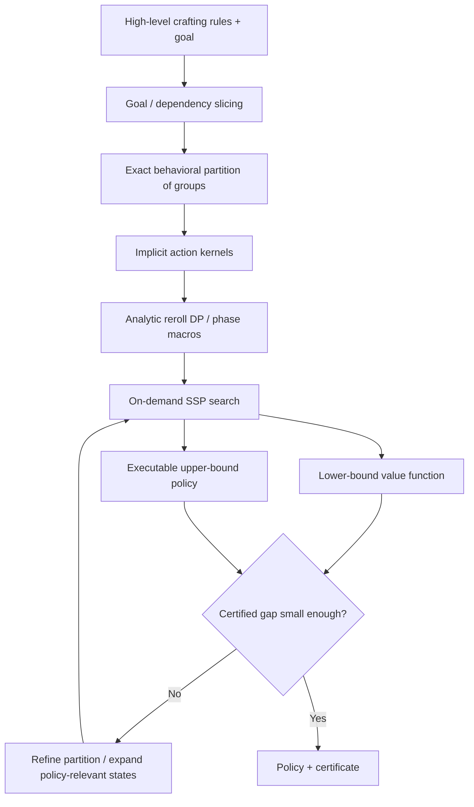

# Second opinion on the crafting optimizer: mathematical model, structural shortcuts, and limits

## Executive verdict

The uploaded problem is correctly recognized as a finite, fully observable **stochastic shortest-path Markov decision process (SSP-MDP)** with positive action costs, an absorbing goal, many near-self-loops, and a highly structured transition generator. That is the right *semantic* model. The likely mistake is not the SSP formulation; it is treating the induced explicit transition graph as the primary computational object. Your current pipeline materializes hundreds of millions of transitions even though the underlying problem description is compact and strongly symmetric. fileciteturn0file0 Classical SSP theory supports stationary optimal policies and Bellman equations under standard properness conditions, and positive costs give particularly useful error bounds. citeturn889392search10turn889392search0

My ranked recommendations are:

1. **Stop building the full transition graph. Replace explicit successor lists by an implicit transition operator plus exact state/action aggregation.** Exact stochastic bisimulation is specifically designed to merge MDP states whose immediate costs and transition probabilities into equivalence classes agree; the quotient preserves optimal values and policies. Coarsest refinements can be computed algorithmically. citeturn777635search27turn777635search5 Your existing “behavioural group types” are already moving in this direction, but the 536-million-edge R04 graph strongly suggests that equivalence is being applied *before outcomes are generated*, rather than to the probability law itself. In particular, outcomes differing only in identities or order of junk groups should usually be collapsed algebraically before an edge ever exists.

2. **Factor full-reroll actions analytically rather than enumerating ~1,500 successor states per reroll.** The draw mechanism is a form of sequential unequal-probability sampling without replacement—closely related to successive PPS sampling and the Plackett–Luce random-ranking law. citeturn592342search10turn592342search44 For goal sets of only 2–6 required elements, one can often compute probabilities over the *required-element mask plus a few capacity/exclusion summaries* with dynamic programming over draws, instead of enumerating junk configurations. The complexity should depend primarily on draw count \(k\le6\), the number of required groups, and the number of behavioural pool classes—not on the number of concrete junk outcomes.

3. **Use heuristic/on-demand SSP search or constraint generation rather than exhaustive reachability.** LAO* was developed precisely to solve cyclic SSPs while expanding only states relevant to the current solution graph; LRTDP and related methods likewise avoid uniformly solving the entire reachable MDP. citeturn777635search0turn777635search4 For your “single starting object, single user query” use case, computing a globally optimal value for every reachable state is usually wasted work. You need an \(\varepsilon\)-optimal policy from one initial state. The important caveat is that ordinary heuristic search needs a sound lower bound and a proper upper-bound policy if you want the guarantees you require; Hansen's SSP residual/bounding work is directly relevant. citeturn777635search3turn889392search0

4. **Treat repeat-until-success phases as semi-Markov macro-actions whenever the continuation condition is fixed.** If repeated action \(a\) from state \(s\) returns to exactly \(s\) with probability \(p\), costs \(c\), and exits to \(j\) with one-step probability \(q_j\), your current transformation is exact:
   \[
   C_{\rm macro}=\frac{c}{1-p},\qquad
   P_{\rm macro}(j)=\frac{q_j}{1-p}.
   \]
   More generally, any *closed transient set under a fixed policy* can be collapsed exactly by an absorbing-chain calculation using its fundamental matrix. This generalizes your scalar self-loop elimination from a one-state geometric loop to a whole repeat phase. It is standard Markov-chain absorption mathematics, and it can convert multi-state crafting routines into single macro-actions without sacrificing optimality **provided decisions are not allowed inside the collapsed region**.

5. **Use probabilistic-model-checking techniques as the verification architecture.** Modern model checkers combine SCC decomposition, sound lower/upper iterations, exact or rational arithmetic where necessary, bisimulation/symmetry minimization, symbolic representations, and independently checkable policies. Storm, for example, supports explicit and symbolic models, multiple numerical solvers, bisimulation minimization, and abstraction. citeturn889392search4 A 2026 practitioner survey finds optimistic/sound value iteration a sensible default for many MDP verification tasks, while noting that LP, policy iteration, and exact arithmetic dominate in particular regimes. citeturn889392search3

The central diagnosis is therefore:

> **Your model is right; your unit of computation is too concrete.**  
> The highest-payoff work is to collapse probability laws, not merely states, and to solve only the policy-relevant quotient from the requested initial state.

I did **not** find a general theorem implying that crafting problems of your stated form admit short phase-structured optimal strategies, a Gittins index, or a polynomial-time exact algorithm. Existing structural theorems require much stronger decomposability or monotonicity assumptions than your operations appear to satisfy. citeturn987581search0turn987581search29

## Related fields and what is actually reusable

### Stochastic shortest path and probabilistic planning

SSP is the closest established model. Bertsekas and Tsitsiklis prove the fundamental Bellman and stationary-policy results for finite SSPs under properness-type assumptions; with an absorbing goal and positive operation prices, your model is especially well behaved compared with general undiscounted MDPs. citeturn889392search10turn889392search11 Positive action costs also permit computable suboptimality bounds from Bellman residuals even when not every policy is proper. citeturn889392search0

What probabilistic planning contributes is mainly **search discipline**. LAO* solves cyclic MDP solution graphs without enumerating the entire reachable state space. citeturn777635search0 LRTDP focuses computation on states encountered under greedy trials and labels solved regions, although low-probability branches can still make naive RTDP convergence troublesome. citeturn777635search4 This is a better match for a query-specific craft optimizer than “construct everything, then solve.”

There is also work specifically on **succinct SSPs**, where the MDP is represented by variables and transition rules rather than explicitly enumerated states. Such work derives upper and lower bounding methods directly from the compact description. citeturn300170search20 That literature is conceptually closer to your implementation challenge than generic explicit-state policy iteration.

### Probabilistic model checking, bisimulation, and symmetry

Probabilistic model checking has spent decades fighting exactly the phenomenon you observe: a small high-level system description giving rise to enormous explicit Markov models. Standard responses include symbolic representations, SCC/topological solving, symmetry reduction, bisimulation quotienting, abstraction/refinement, and sound interval algorithms. citeturn889392search4turn352856search7

For MDPs, **stochastic bisimulation** gives an exact equivalence relation: states can be merged when corresponding actions have equal immediate reward/cost and equal total transition probability into every equivalence class. The optimal policy of the quotient induces an optimal policy in the original MDP. citeturn777635search48turn777635search27 This is stronger and more principled than manually deciding which “junk” distinctions seem irrelevant.

Symmetry reduction is equally relevant. Probabilistic-model-checking implementations have demonstrated large reductions using symbolic quotient construction when replicated components are interchangeable. citeturn777635search8turn777635search12 Your mutually interchangeable junk groups are almost a textbook source of symmetry.

The sound-value-iteration literature is also directly applicable. Interval/sound VI maintains lower and upper bounds with a mathematically valid termination condition instead of relying on a raw iterate difference. citeturn352856search2turn352856search1 That is the right conceptual framework for your demanded “certified 1%” approximate mode.

### Unequal-probability sampling without replacement, urns, and coupon collectors

Your reroll mechanism is **not** the ordinary coupon collector. One reroll performs a small weighted sample without replacement, with group exclusion and P/S capacity constraints; repeated rerolls then form independent attempts only if the object is completely reset to the same effective pool before each try.

Sequential drawing where the next item is chosen proportionally to its remaining weight is known as **successive probability-proportional-to-size sampling without replacement**, and closely matches a partial Plackett–Luce ranking. citeturn592342search10turn592342search44 The Plackett–Luce formulation gives the probability of an ordered outcome as a product of conditional weight ratios. This means a concrete ordered draw of \(i_1,\ldots,i_k\) has probability
\[
\prod_{t=1}^{k}
\frac{w_{i_t}}
{\sum_{j\in A_t} w_j},
\]
where \(A_t\) is the eligible set after earlier exclusions and capacity updates. The difficulty is summing this law over many orders and many junk identities.

Wallenius' noncentral hypergeometric distribution is another biased-without-replacement urn model, with numerical algorithms for its probabilities. citeturn889392search8 But it does **not** automatically solve your exact problem: your exclusions are at the *group* level, elements within groups can have distinct goal relevance, and type capacities change the eligible set. It is therefore useful as mathematical context, not as a drop-in distribution.

The coupon-collector literature is most useful only one level higher: when repeated attempts independently acquire one of several required categories. Nonuniform coupon collectors have exact inclusion–exclusion expressions and asymptotic results, and variants with resets are known. citeturn987581search22turn987581search8 However, because one of your rerolls can simultaneously add several required items and destroy existing ones, the generic crafting process does not reduce to a classical coupon collector.

### Bandits, search theory, optimal stopping, and stochastic scheduling

A **Gittins index** exists because the classical multiarmed bandit decomposes into independent projects whose unplayed states are frozen and whose objective has a specific discounted/separable form. citeturn987581search1turn987581search48 More general indexability results rely on conservation laws and decomposability conditions. citeturn987581search0

Your operations generally violate those conditions. Two different operations act on the **same object state**; choosing one changes the future effectiveness of all others; slot capacities couple goals; removals can destroy progress; and group exclusion creates cross-element interaction. I therefore found no basis for a Gittins-style scalar index ordering your operation types in general.

Optimal stopping is relevant to **peek-then-choose** operations. If the peek reveals a proposed transition and the choice is “accept this outcome or retain the current state,” the action is naturally a chance node followed by a Bellman minimization:
\[
Q(s)=c_{\rm peek}+
\mathbb E_y\left[\min\{V(s),\,C_{\rm accept}(y)+V(T(s,y))\}\right].
\]
This can be compiled out analytically once \(V\) is known; it does not require introducing a permanent expanded state. Threshold structure may arise if outcomes admit a one-dimensional ordering and the continuation value is monotone, but general monotone-policy theorems require stochastic monotonicity plus sub/supermodularity or related “increasing differences” assumptions. citeturn987581search29turn987581search32 Your set-valued goal state is only partially ordered and destructive operations break obvious monotonicity, so a global threshold theorem should not be assumed.

### Reliability, absorption, and stochastic scheduling

Reliability and absorbing-Markov-chain techniques are useful for **fixed policies or fixed phases** rather than for choosing the policy. If a sub-strategy says “continue this fixed rule until hitting boundary set \(B\),” the transient-state matrix \(Q\) can be eliminated exactly via \((I-Q)^{-1}\). This yields expected accumulated costs and exit probabilities. That is a potentially large generalization of your self-loop shortcut.

The same idea appears algorithmically as eliminating internal states in probabilistic models. It is most attractive when a crafting phase has only a handful of internal abstract states but would otherwise be traversed repeatedly.

## Closed forms and exact sub-strategy compilation

Consider a reroll that always returns to the same pre-reroll state if it does not meet some stopping predicate \(E\). If each attempt costs \(c\) and succeeds independently with probability \(q\), then
\[
N\sim\operatorname{Geom}(q),\qquad
\mathbb E[N]=\frac1q,\qquad
\mathbb E[C]=\frac{c}{q}.
\]
This is elementary geometric renewal mathematics and is exactly your one-state self-loop elimination.

If success has several exit outcomes \(z\), with per-attempt probabilities \(p_z\), then \(q=\sum_zp_z\), and the compiled macro-action has
\[
P(Z=z\mid \text{eventual exit})=\frac{p_z}{q},
\qquad
E[C]=\frac c q.
\]
Thus **“reroll until predicate \(E\), then continue optimally from the observed successful result” is a valid exact macro-action** when all failed attempts return to an identical abstract state.

The major computational problem is therefore calculating \(q\) and the distribution over successful goal-relevant summaries without expanding all junk.

For draw count \(k\le6\), I would compute that distribution with a **small exact dynamic program over sufficient aggregate pool statistics**. A DP state need contain only quantities that can affect future denominators: draw position; remaining P/S capacity; which required/exclusion groups have already been selected; and counts/total weights of each interchangeable behavioural class remaining. Because drawing one group removes the entire group, the class update is by that group's weight signature. This is exact whenever members assigned to the same class truly have identical effects on every future action.

Conceptually:
\[
F(t,c_P,c_S,R,\mathbf n,\mathbf W)
\]
holds a probability mass after \(t\) draws. A transition chooses a required group explicitly or one of a small number of junk classes; its probability is its eligible weight divided by the current total eligible weight. For a junk class containing interchangeable groups, all concrete choices leading to the same new aggregate state are summed in one transition.

This is the specific place where your factor-of-thousands explosion is most plausibly occurring. A full reroll yielding 1,500 abstract successors for a 3–6-element goal means the model is still remembering distinctions among sampled junk that matter to your *representation* but not necessarily to the *future Bellman equation*.

There is no general polynomial-time formula for arbitrary weighted group-exclusion/capacity sampling that I found. Even ordinary successive unequal-probability sampling has nontrivial inclusion probabilities, and survey-sampling research distinguishes several inequivalent without-replacement designs precisely because the subset law is complicated. citeturn592342search4turn592342search9 So the right target is not “find one magic named distribution,” but **fixed-parameter exact dynamic programming** exploiting \(k\le6\), \(|R|\le6\), and few behavioural classes.

A second exact compilation opportunity is a **multi-state phase**. Suppose a chosen local rule \(\pi\) is followed until reaching boundary states \(B\). Let \(Q_\pi\) be the transition matrix among internal transient states, \(R_\pi\) transitions to boundary states, and \(g_\pi\) one-step cost. Then:
\[
N=(I-Q_\pi)^{-1},\qquad
C=N g_\pi,\qquad
P_{\rm exit}=N R_\pi.
\]
The phase can then appear in the outer MDP as a macro-action with cost \(C(s)\) and exit distribution \(P_{\rm exit}(s,\cdot)\). The catch is crucial: this is exact only after fixing the decisions inside the phase. If a globally optimal policy might want to switch operations halfway through, premature phase compilation can remove the optimum.

That suggests a useful algorithmic compromise: generate candidate phase policies automatically, solve them exactly as local absorbing chains, and retain them as *additional* macro-actions while keeping the primitive actions. Macro-actions then accelerate solving without restricting the policy class.

## Structural results: where stage policies exist, and why they probably do not exist globally here

The strongest generic route to threshold or phase structure is **monotone dynamic programming**. If states and actions can be ordered, transition kernels preserve stochastic order, and action-value differences satisfy submodularity or supermodularity, Topkis-type results yield monotone optimal selectors. citeturn987581search29turn987581search32 Classic inventory replacement, queueing, and stopping models exploit precisely this structure.

Your natural “more required mods present is better” relation is a **partial** order, and several mechanics violate monotone progression: full rerolls destroy unprotected good elements; removal can be beneficial because it frees capacity; deterministic crafting can block a mutually exclusive group; protection changes future transition laws; and finalize is irreversible. Hence a state with a superset of current goals need not dominate one with fewer goals if its remaining slots or flags are worse. This prevents importing a blanket “acquire goals one at a time in a fixed order” theorem.

There may nevertheless be **local monotonicity theorems** for restricted subsets of operations. For example:

- If no operation ever destroys a required element and every added required element weakly reduces the remaining completion cost, the required-set lattice becomes monotone.
- If two operations differ only by success probability and price, with identical conditional success distributions and identical failure state, comparing \(c/q\) exactly orders them.
- If action \(A\) has no larger immediate cost and its transition distribution first-order stochastically dominates \(B\) with respect to a verified monotone value lower/upper bound, \(B\) can be discarded by dominance.
- If one operation is followed by an operation that *completely erases every state component the first operation can affect*, the earlier operation is Bellman-irrelevant except for persistent flags/costs. Your “make it rare, then an operation erases everything anyway” case is exactly the kind of situation that a dependency/liveness analysis should remove before state expansion.

That last point is likely very high leverage. It is analogous to dead-variable elimination in compilers and cone-of-influence reduction in model checking: if a state variable cannot influence the goal, future enabled actions, costs, or any transition probability after some point, it should not survive into the model. Probabilistic-model-checking systems heavily exploit property-directed reduction and abstraction for this reason. citeturn352856search7

I found **no theorem** supporting a universal short sequence of “repeat A until condition, then B” phases for your full operation language. Likewise, I found no general interchange argument that totally orders operations. Such results would require restrictions that remove the cross-coupling which makes this an MDP in the first place.

## Complexity limits and what restrictions can rescue you

An **explicit finite MDP** with rational transition probabilities can be solved by linear programming in time polynomial in the explicit input size. The catch is that “explicit input size” includes every state-action-transition entry; a 536-million-transition model is therefore already enormous before any optimizer is invoked. The 2026 model-checking survey explicitly contrasts theoretically polynomial LP formulations with iterative algorithms whose practical behavior is often preferable. citeturn889392search3

Once the MDP is represented **succinctly/factorially**, complexity changes dramatically. Mundhenk, Goldsmith, Lusena, and Allender show broad intractability results for succinct and partially observable finite-horizon MDP variants, including PSPACE- and EXPTIME-level completeness depending on representation, policy type, and horizon. citeturn352856search4turn352856search3 Later treatments summarize factored finite-horizon and SSP planning as EXPTIME-complete in general compact representations. citeturn889392search6 So there is no reason to expect a generic polynomial-time algorithm in the size of your high-level crafting rules.

This distinction is important:

\[
\text{compact crafting description}
\;\ll\;
\text{reachable states}
\;\ll\;
\text{explicit transitions}.
\]

Your desired “seconds for every user configuration” cannot be guaranteed for the unrestricted language unless additional structure is exploited. The complexity literature essentially rules out that ambition for arbitrary succinct MDPs, barring major complexity-class collapses. citeturn352856search4

The restrictions in your application that *do* offer hope are unusually strong:

- object capacity is at most six;
- goals contain only 2–6 distinguished elements;
- draw depth per reroll is at most six;
- many of the hundreds of non-goal elements are interchangeable under a query;
- action costs are positive;
- the target is absorbing;
- one initial state, rather than all states, matters;
- most user queries enable only a subset of the 10,000 syntactic operation/modifier combinations.

Those are fixed-parameter and quotient opportunities, not generic MDP properties. I would architect the solver around them explicitly.

Risk objectives require separate caution. Optimizing **p90/VaR** is not equivalent to expected-cost SSP and is generally non-additive; quantile MDPs require specialized dynamic programming and raise time-consistency issues. citeturn300170search0turn300170search2 CVaR SSP has dedicated exact LP/value-iteration methods. citeturn300170search1 Therefore “report p50/p90/CVaR under the expected-cost-optimal policy” is straightforward policy evaluation, but “minimize p90” or “minimize CVaR” is a genuinely different optimization problem and should not be implemented by merely replacing the Bellman objective scalar.

Inventory constraints such as “own at most 80,000 uses of A” similarly break the stationary SSP unless remaining inventory is added to the state or handled through a constrained-MDP formulation. A literal counter up to 80,000 would be disastrous; Lagrangian/resource-constrained methods or action-count occupation measures are preferable where applicable.

## Critique of the current pipeline and a replacement architecture

Your **self-loop elimination is good** and should be generalized, not removed. The SCC decomposition is also sound and standard; topological processing of components is widely used in MDP/model-checking solvers. citeturn352856search1turn777635search29 The costly choice is “build the whole graph.”

The R04 numbers are diagnostic. 177,242 states is not itself terrifying; 535.9 million stored transitions is. At even 16 bytes per edge, raw edge data alone would exceed 8 GB before Python/container overhead. Your observed 6.3 GB graph and 15.7 GB solve peak are therefore consistent with **transition fan-out, not the Bellman vector, dominating memory**. That is a measured result from your instance, not a literature claim. fileciteturn0file0

The first replacement I would implement is:

**Goal/dependency slicing** should occur before reachability. Build a dependency graph from each state feature to every action precondition, probability denominator, cost, successor feature, and target predicate. Remove anything outside the backward cone of influence. This should catch operations whose effects are certainly overwritten before they can matter.

**Behavioral partitioning** should use the strongest exact equivalence you can prove. Do not classify groups merely by static tags. Two groups are equivalent for a query if every enabled operation maps them to the same equivalence classes with the same aggregated probabilities and costs. That is essentially property-directed stochastic bisimulation. citeturn777635search27

**Implicit kernels** should expose methods like

\[
\texttt{backup}(s,a,V)
=
c(s,a)+\sum_{s'}P(s'|s,a)V(s')
\]

without constructing \((s,a,s',p)\) records. For rerolls, the sum should be evaluated by the small combinatorial DP described above. This may turn a 1,500-edge action into a few dozen DP nodes.

**On-demand solving** should begin from the user's initial state with admissible lower and upper bounds. LAO*/LRTDP-style algorithms are natural candidates, but given your insistence on certificates I would combine search with sound bounding rather than transplanting them unchanged. citeturn777635search0turn777635search3

**Abstraction refinement** is the right framing for your approximate mode. Model-checking tools routinely compute conservative lower/upper abstractions and refine until the property is decided or the gap closes. citeturn889392search4turn352856academia6 Your existing optimistic/pessimistic coarse models are therefore on a strong conceptual path; the improvement is to refine based on **Bellman decision relevance**—split only blocks whose uncertainty can change the minimizing action at currently relevant states.

For first-level-offer pruning, spending half the runtime on exact bounds suggests the bounds themselves should be cached or derived compositionally. If an offer has lower bound \(L_a\) and the current best executable policy gives \(U\), discard \(a\) when \(L_a\ge U\). That principle is exact. The engineering issue is to make \(L_a\) cheap: relaxed-capacity models, ignored-exclusion models, zero-cost deterministic finishes, and goal-wise decompositions can provide admissible bounds without partially solving the exact offer.

## Verification, confidence, and references

For small instances, an **LP oracle** is an excellent gold standard. Explicit SSP Bellman optimality can be represented as a linear program, so comparing your custom solver against an independent LP implementation catches both transition-generation and solver errors. The 2026 practitioner survey explicitly treats LP, policy iteration, value iteration, and exact-arithmetic variants as complementary verification algorithms. citeturn889392search3

For large instances, the strongest practical package of evidence would be:

1. Emit the final stationary policy and independently evaluate it by solving its induced Markov chain, giving a certified **upper bound** on optimal expected cost.
2. Emit a Bellman-feasible lower-bound vector or appropriate dual/LP certificate, giving a **lower bound**.
3. Report \(U(s_0)-L(s_0)\) and the relative gap at the actual initial state, not only a global iterate residual.
4. For reduced models, test the claimed equivalence relation mechanically: immediate costs must match, enabled action correspondence must match, and transition masses into every quotient block must match.
5. Cross-check thousands of tiny random instances against a separate explicit enumerator plus rational-arithmetic LP.
6. Property-test the probability generator: all probabilities nonnegative, exact mass one, group exclusivity respected, capacities respected, forced/banned/tag-weight variants agreeing with brute-force enumeration on tiny pools.
7. Monte Carlo the **fixed returned policy** only as an external sanity check for cost distribution and p50/p90/CVaR—not as an optimality argument.

This is aligned with probabilistic-model-checking practice: correctness rests on sound numerical bounds, exact transformations, independent algorithmic formulations, and—where feasible—exact arithmetic or independently checkable certificates rather than simulation alone. citeturn352856search1turn889392search3 Storm's architecture is a useful reference because it deliberately supports several independent solver backends and both explicit and symbolic representations. citeturn889392search4

For risk reporting under a fixed policy, the induced system is just an absorbing Markov chain with accumulated costs. If operation prices lie on a manageable integer lattice, exact or FFT-style convolutions / generating functions may compute the cumulative-cost distribution; otherwise one can use numerical transforms or simulation as a secondary estimate. For *optimizing* p90 or CVaR, use the specialized quantile/CVaR MDP theory rather than the expected-cost Bellman equation. citeturn300170search0turn300170search1

The most useful experiments before a major rewrite would be to instrument R04 and answer four questions: how many of the 1,500 reroll successors have identical Bellman-relevant signatures; how many concrete group identities remain in each signature; how many states are ever visited under the current optimal/near-optimal policy from the actual start; and how much of the graph disappears after backward dependency slicing. Those measurements will tell you whether the primary gain lies in kernel aggregation, state quotienting, or on-demand search.

### Selected references

Bertsekas, D. P., & Tsitsiklis, J. N. (1991), *An Analysis of Stochastic Shortest Path Problems*, Mathematics of Operations Research 16(3), 580–595. Fundamental SSP theory. citeturn889392search10

Hansen, E. A. (2011), *Suboptimality Bounds for Stochastic Shortest Path Problems*, UAI. Bellman-residual bounds for positive-cost SSPs. citeturn889392search0

Hansen, E. A., & Zilberstein, S. (2001), *LAO*: A Heuristic Search Algorithm that Finds Solutions with Loops*, Artificial Intelligence 129, 35–62. On-demand cyclic SSP search. citeturn777635search0

Bonet, B., & Geffner, H. (2003), *Labeled RTDP: Improving the Convergence of Real-Time Dynamic Programming*. Trial-based SSP solution. citeturn777635search26

Givan, R., Dean, T., & Greig, M. (2003), *Equivalence notions and model minimization in Markov decision processes*, Artificial Intelligence. Exact stochastic-bisimulation reduction preserving optimal policies. citeturn777635search27

Dean, T., & Givan, R. (1997), *Model Minimization in Markov Decision Processes*. Coarsest homogeneous refinement. citeturn777635search5

Quatmann, T., & Katoen, J.-P. (2018), *Sound Value Iteration*. Certified lower/upper iteration for probabilistic model checking. citeturn352856search1

Haddad, S., & Monmege, B. (2018), *Interval iteration algorithm for MDPs and IMDPs*. Sound interval iteration and convergence. citeturn352856search2

Hartmanns, A. et al. (2026), *The revised practitioner's guide to MDP model checking algorithms*. Current survey comparing VI, optimistic VI, policy iteration, LP, and exact arithmetic. citeturn889392search3

Dehnert, C., Junges, S., Katoen, J.-P., & Volk, M. (Storm), *The probabilistic model checker Storm*. Symbolic/explicit MDP algorithms, bisimulation, abstraction, and multiple numerical backends. citeturn889392search4

Kwiatkowska, M., Norman, G., & Parker, D., *Symmetry Reduction for Probabilistic Model Checking*. Exact symmetry reduction for probabilistic models. citeturn777635search12

Mundhenk, M., Goldsmith, J., Lusena, C., & Allender, E. (2000), *Complexity of finite-horizon Markov decision process problems*, Journal of the ACM 47(4), 681–720. Succinct-MDP complexity. citeturn352856search4

Chatterjee et al., *Computational Approaches for Stochastic Shortest Path on Succinct MDPs*. Bounds without fully expanding compact SSP models. citeturn300170search20

Fog, A. (2008), *Calculation Methods for Wallenius' Noncentral Hypergeometric Distribution*. Biased sampling without replacement. citeturn889392search8

Gile et al., treatment of **successive sampling/PPSWOR**, describing sequential probability-proportional-to-size drawing without replacement. citeturn592342search10

Gittins, J. C. (1979), *Bandit Processes and Dynamic Allocation Indices*, JRSS B. Classical index decomposition and its restrictive structure. citeturn987581search26

Bertsimas & Niño-Mora (1996), *Conservation Laws, Extended Polymatroids and Multiarmed Bandit Problems*. Structural characterization of indexable systems. citeturn987581search0

Topkis, D. M., *Minimizing a Submodular Function on a Lattice* and later monotone comparative-statics work. Foundation for monotone/threshold-policy sufficient conditions. citeturn987581search32

Li et al. (2022), *Quantile Markov Decision Processes*, Operations Research. Dynamic programming for quantile objectives and discussion of time consistency. citeturn300170search2

Meggendorfer, T. (2022), *Risk-Aware Stochastic Shortest Path*, AAAI. Exact CVaR algorithms for SSPs. citeturn300170search1